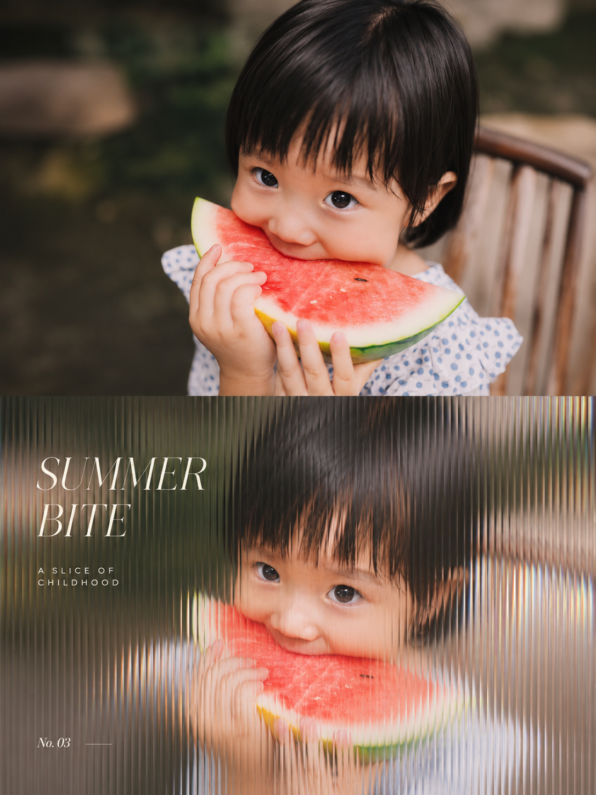
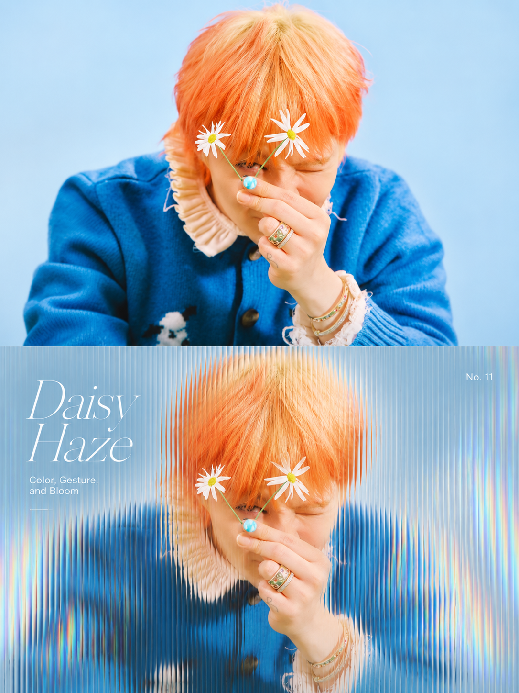

# 长虹玻璃折射照片风格 SKILL

`zheshe` 是一个用于制作艺术海报的 AI Agent Skill。每张上传照片对应一张 3:4 竖版海报。上半区保留原照，下半区用满版超细长虹玻璃折射同一张照片。焦点清晰可辨，边缘逐渐化为纵向光带。

## 使用

在能够读取 GitHub 仓库并编辑图像的 AI Agent 会话中上传原始照片。复制下面的指令（含 GitHub 仓库网址），和照片一起发送。

```text
请打开 https://github.com/jacky654512223/zheshe，
读取仓库中的 zheshe/SKILL.md，并按其中的要求处理我上传的照片。
每张照片单独生成一张 3:4 竖版长虹玻璃折射双联海报。请逐张交付成品。
```

## 效果示例

以下八张示例由用户提供。点击可查看完整 PNG。

<a href="examples/summer-breeze.png"></a>
<a href="examples/summer-bite.png"></a>
<a href="examples/refraction-study.png"></a>
<a href="examples/sky-motion.png"></a>
<a href="examples/daisy-haze.png"></a>
<a href="examples/blue-poise.png"></a>
<a href="examples/golden-hour.png"></a>
<a href="examples/summer-diary.png"></a>
