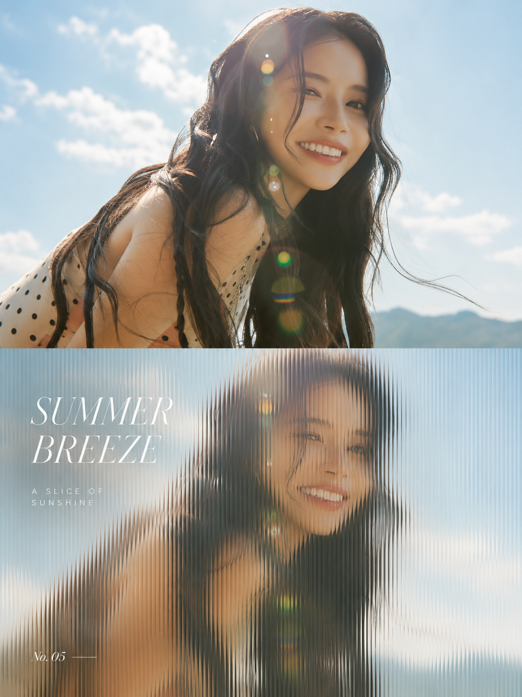
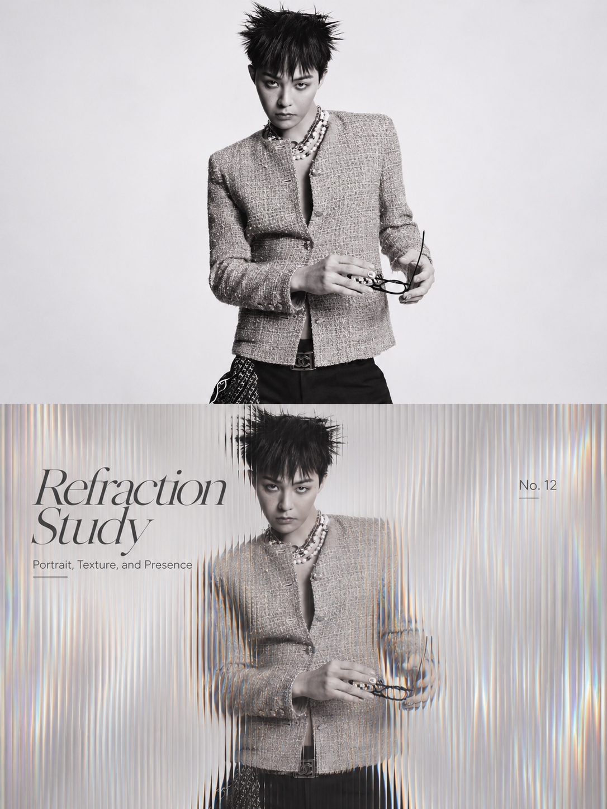
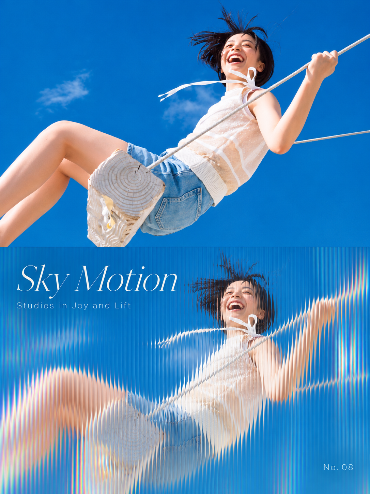
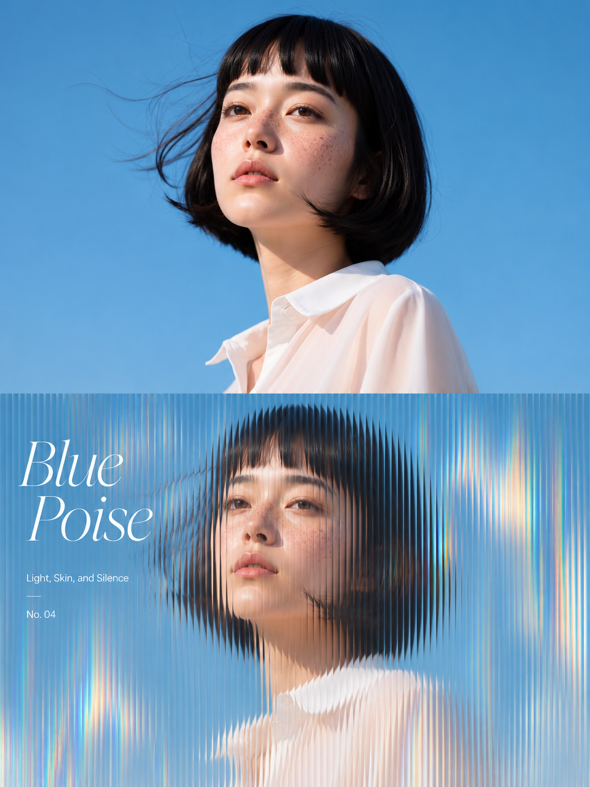
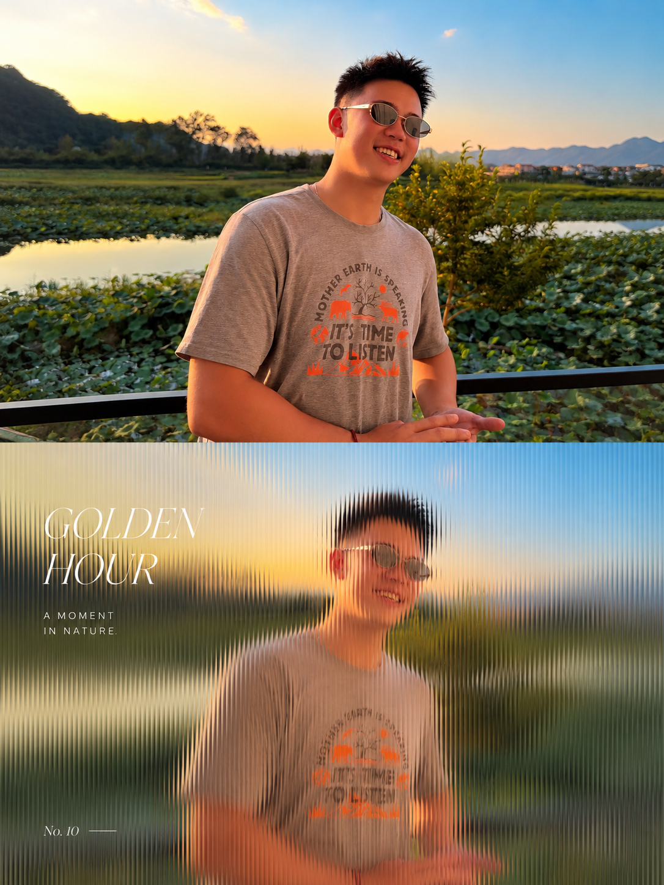
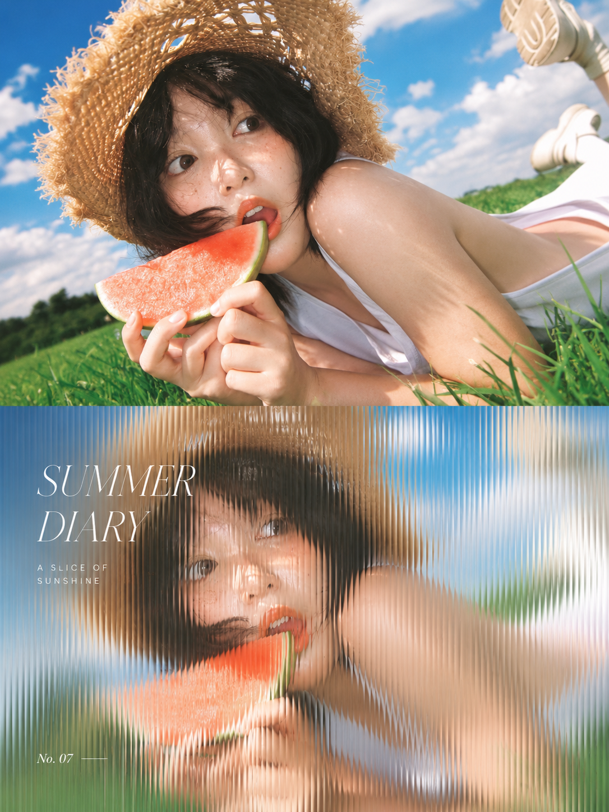

# 折光双联

`zheguang` 是一个用于制作艺术海报的 Codex Skill。每张上传照片对应一张 3:4 竖版海报。上半区保留原照，下半区用满版超细长虹玻璃折射同一张照片。焦点清晰可辨，边缘逐渐化为纵向光带。

## 使用

把 [`zheguang`](zheguang/) 文件夹复制到 Codex 的技能目录，例如 `~/.codex/skills/`。在支持图像编辑的会话里上传待处理原照并调用技能。

```text
使用 $zheguang，把我上传的每张照片分别制作成 3:4 的长虹玻璃双联海报。
```

## 效果示例

以下八张示例由用户提供。点击可查看完整 PNG。

<a href="examples/summer-breeze.png"></a>
<a href="examples/summer-bite.png"></a>
<a href="examples/refraction-study.png"></a>
<a href="examples/sky-motion.png"></a>
<a href="examples/daisy-haze.png"></a>
<a href="examples/blue-poise.png"></a>
<a href="examples/golden-hour.png"></a>
<a href="examples/summer-diary.png"></a>
